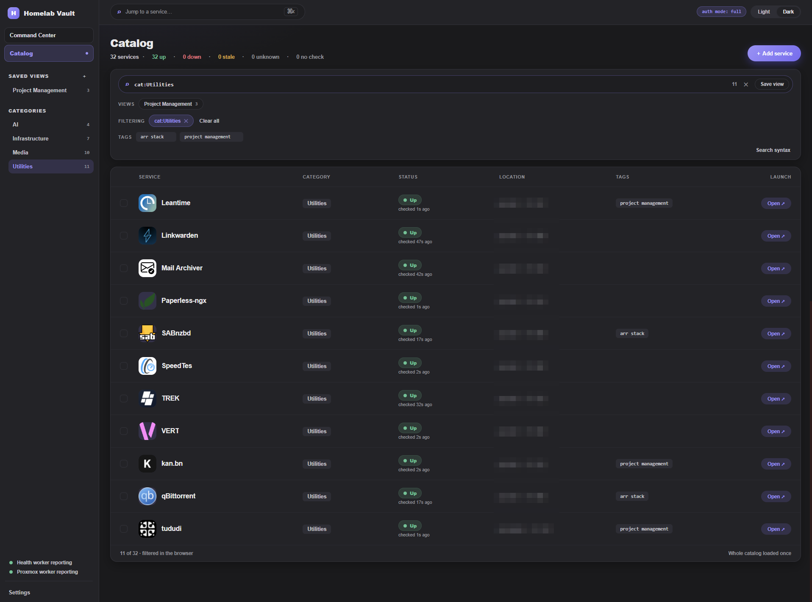
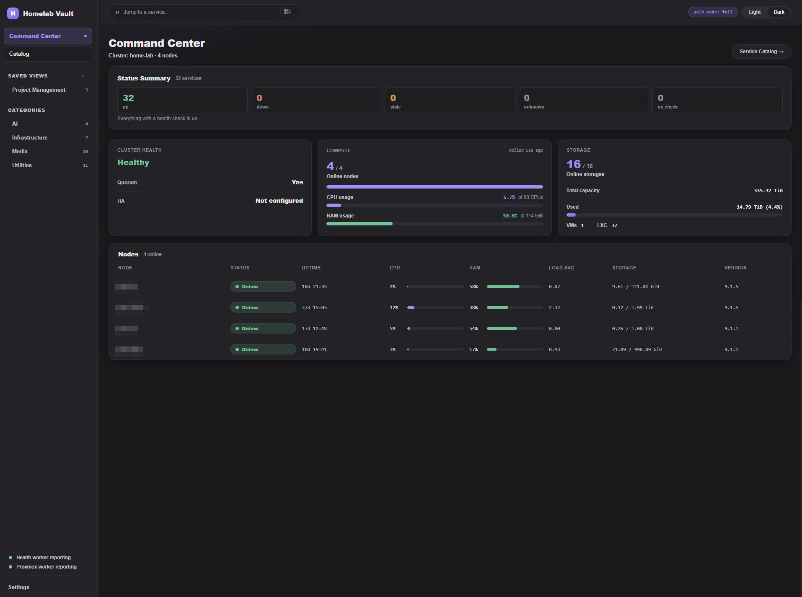
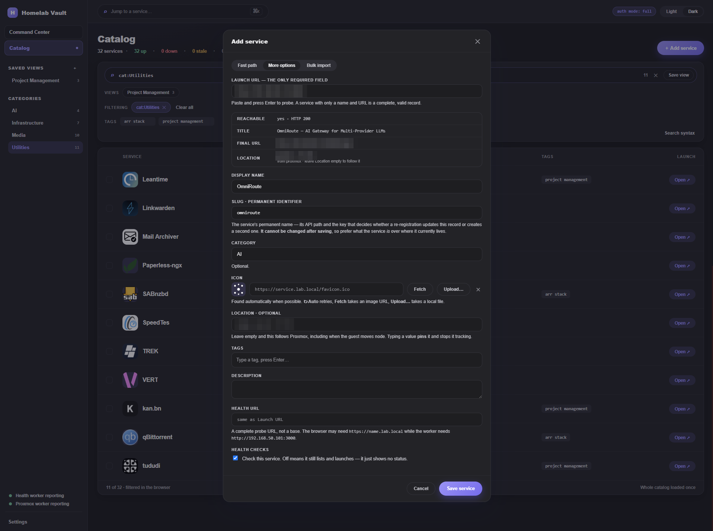

# Homelab Vault

[](LICENSE)

> An API-first, self-hosted service catalog for humans and infrastructure agents.

**Find a service → see if it is alive → open it.**

Homelab Vault gives a homelab a searchable source of truth for the services it runs. It records where services live, checks whether they are healthy, and provides a fast way to open them. People can use the web interface; automation and local LLM-based infrastructure agents can use the authenticated API.

<p align="center">
  <a href="docs/images/catalog.png"></a>
  <a href="docs/images/dashboard.png"></a>
  <a href="docs/images/add-service.png"></a>
</p>

## Why Homelab Vault exists

Homelab dashboards are often maintained as YAML files. That is reasonable for rendering a static page, but it is a poor maintenance interface for automation:

- Updating nested YAML safely is brittle.
  
- Agents must preserve unrelated entries and formatting.
  
- Concurrent edits can overwrite each other.
  
- Validation and authorization are difficult to express consistently.
  
- Presentation configuration becomes the accidental source of truth.
  

Homelab Vault was built as an alternative to that workflow. The database and API are authoritative. The web UI, health workers, recovery export, and future integrations are clients of the same source of truth.

An infrastructure agent should be able to register a service or update its metadata with a validated API request—not by rewriting a dashboard file.

#### A note from the author

I designed Homelab Vault to solve a problem in my own infrastructure: using YAML as the maintenance interface for a homelab dashboard made it unnecessarily difficult for automation and local LLM-based infrastructure agents to update service information safely.

I define the product direction, architecture, user experience, and operational requirements. The implementation is produced with AI-assisted development tools, supported by a workflow built around written specifications, automated tests, security review, live-deployment validation, and documented operational checks.

This is an actively developed self-hosted project, not a hosted commercial service. It reflects the needs of my own homelab and will continue to evolve as those needs change. Services, interfaces, and integrations may change over time as I use the project, learn what works, and respond to feedback from other users.

Please review the configuration and security model before exposing an instance beyond a trusted network.

## What it provides

- **Searchable service catalog** with stable slugs and categories.
  
- **Health-aware status** with configurable intervals, timeouts, and failure thresholds.
  
- **API-first writes** for scripts, automation, and scoped infrastructure agents.
  
- **Human-friendly web UI** for browsing and editing the catalog.
  
- **Optional Proxmox enrichment** showing the node and guest associated with a service.
  
- **Static recovery export** that remains usable when the application is unavailable.
  
- **Database backups and restore documentation** for operational recovery.
  
- **Health endpoint and external watchdog** for monitoring the monitor.
  

## Architecture

```text
backend/    Django + Django Ninja API and workers

frontend/   Vue 3 + Vite single-page application

ops/        backup and external watchdog scripts


web         Django application and compiled SPA

worker      HTTP health checks

proxmox-worker  optional Proxmox location enrichment

db          PostgreSQL
```

The default deployment uses Docker Compose:

- **Backend:** Django + Django Ninja
  
- **Frontend:** Vue 3, Vite, and Whitenoise
  
- **Database:** PostgreSQL
  
- **Workers:** asyncio + httpx
  
- **Packaging:** Docker Compose
  

## Quick start

### Requirements

- Docker Engine
  
- Docker Compose
  
- A host with persistent storage for PostgreSQL and backups
  

### Start the application

```bash
git clone https://github.com/shaxs/homelab-vault.git

cd homelab-vault


cp .env.example .env
```

Set the required values in `.env`:

```text
SECRET_KEY=<random-secret>

POSTGRES_PASSWORD=<database-password>

HOMELABVAULT_ADMIN_TOKEN=<admin-token>
```

Generate random values with:

```bash
openssl rand -hex 32
```

Prepare the recovery-export directory. The containers write as UID `10001`:

```bash
mkdir -p _export

chown 10001:10001 _export
```

Start the stack:

```bash
docker compose up --build -d
```

Open:

```text
http://localhost:8000
```

A new installation starts with an empty catalog. Add the first service from the web interface or through the API.

Proxmox integration is optional. With `PROXMOX_HOST` unset, the catalog still works normally without polling or location enrichment.

## API

The API is the primary machine interface. The generated OpenAPI schema is available at:

- <http://localhost:8000/api/v1/docs>
  
- <http://localhost:8000/api/v1/openapi.json>
  

All API endpoints live under `/api/v1/`.

Reads are unauthenticated by design. Writes use either an admin session or a scoped bearer token:

```bash
curl -X POST http://localhost:8000/api/v1/services \
  -H "Authorization: Bearer $HOMELABVAULT_AGENT_TOKEN" \
  -H "Content-Type: application/json" \
  -d '{"launch_url":"https://example.internal"}'
```

The minimum service record is a `launch_url`. The API derives a stable slug from the URL when one is not supplied, and repeated writes for the same slug update the existing record rather than creating duplicates.

Agent tokens are intended for automation and can be limited to catalog reads and writes. Administrative operations remain protected by the admin token.

## Security model

The catalog is readable without authentication so it can function as a simple internal home page. That also means an instance exposes its service inventory to anyone who can reach it.

> Do not expose Homelab Vault beyond a trusted network without adding an appropriate authentication and access-control layer.

The application includes several defensive controls:

- Browser-target URLs must use `http://` or `https://` at write time.
  
- Health URLs support `http://`, `https://`, and `tcp://host:port`.
  
- Probe endpoints are admin-only and restricted by network allowlists.
  
- Loopback, link-local, and cloud-metadata addresses are blocked.
  
- Redirects are limited and revalidated at every hop.
  
- Fetches have timeout and response-size limits.
  
- Dangerous URL schemes cannot be stored for future renderers to mishandle.
  
- Secrets remain in environment configuration and are not stored in catalog records.
  

## Configuration

Deployment configuration is supplied through environment variables. Runtime preferences such as the landing page, panel visibility, health thresholds, notifications, and Proxmox display settings are managed in the Settings screen.

The most important settings are:

| Variable | Purpose |
| --- | --- |
| `SECRET_KEY` | Django signing key. |
| `POSTGRES_PASSWORD` | PostgreSQL password. |
| `HOMELABVAULT_ADMIN_TOKEN` | Full administrative access. |
| `HOMELABVAULT_AGENT_TOKEN` | Optional scoped automation access. |
| `HOMELABVAULT_AUTH_MODE` | Write policy: `full`, `open-writes`, or `open`. |
| `WEB_PORT` | Host port for the application. |
| `PROXMOX_HOST` | Optional Proxmox API endpoint. |
| `PROXMOX_API_TOKEN` | Optional read-only Proxmox token. |
| `PROBE_ALLOWED_NETWORKS` | CIDRs the probe and health checker may reach. |
| `STATIC_EXPORT_DIR` | Host directory for the recovery HTML export. |
| `HOMELABVAULT_DISCORD_WEBHOOK_URL` | Optional Discord notification webhook. |

See `.env.example` for the complete configuration reference and safe defaults.

## Backup and recovery

`ops/backup.sh` creates verified, compressed PostgreSQL dumps and retains multiple generations. Set `BACKUP_DIR` to a persistent or mounted location if backups must survive loss of the application host.

The backup is plain SQL. Restore it into an empty database with the application stopped:

```bash
docker compose stop web worker proxmox-worker


docker compose exec db psql -U homelabvault -d postgres \
  -c "DROP DATABASE homelabvault;" \
  -c "CREATE DATABASE homelabvault OWNER homelabvault;"


gunzip -c backups/homelabvault-<timestamp>.sql.gz \
  | docker compose exec -T db psql -U homelabvault -d homelabvault


docker compose start web worker proxmox-worker
```

A backup that has never been restored is an assumption, not a recovery plan. Test the restore procedure before relying on it.

The static recovery export is a dependency-free HTML copy of the catalog. It can be opened with `file://` while the application is offline.

## Monitoring

```text
GET /api/v1/healthz
```

The health endpoint returns `503` when a background worker is stalled and `200` otherwise. `ops/watchdog.sh` can poll the endpoint from outside the Compose stack and notify through the configured Discord webhook if the entire application becomes unreachable.

## Local development

The application uses Python 3.13+, Node 22+, and PostgreSQL.

```bash
python -m venv .venv

. .venv/bin/activate

pip install -r backend/requirements-dev.txt


cd backend

python manage.py migrate

python manage.py runserver
```

In another terminal, workers can be started with:

```bash
python manage.py health_worker

python manage.py proxmox_worker  # optional
```

Build or run the frontend separately:

```bash
cd frontend

npm ci

npm run build

# or: npm run dev
```

Run tests:

```bash
cd backend && python -m pytest

cd frontend && npm test
```

The backend test suite requires a reachable PostgreSQL server. There is no SQLite fallback.

## Project status

Homelab Vault is actively developed for real homelab use. The core catalog, API, health workers, optional Proxmox enrichment, recovery export, and backup workflow are in place. Interfaces and integrations may continue to evolve as I need and as the project gains users.

Issues, suggestions, and focused pull requests are welcome.

## License

Homelab Vault is licensed under the [MIT License](LICENSE).